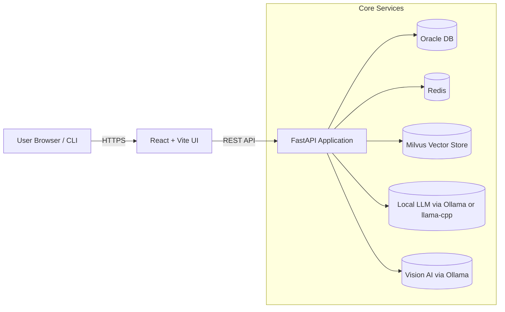

<div align="center">

# 🚀 **ISK-AI RAG System**

### *Enterprise-grade Retrieval-Augmented Generation Platform*

<p align="center">
  
  
  
  
  
  
  
</p>

<p align="center">
  Secure • Scalable • On-Prem • Confidential AI • Enterprise Ready
</p>

</div>

---


## Table of Contents

1. [Architecture Overview](#architecture-overview)  
2. [Getting Started](#getting-started)  
   2.1. [Prerequisites](#prerequisites)  
   2.2. [Docker Quick Start](#docker-quick-start)  
   2.3. [Local Development](#local-development)  
3. [Detailed API Reference](#detailed-api-reference)  
   3.1. [Authentication](#authentication)  
   3.2. [Documents](#documents)  
   3.3. [Chat](#chat)  
   3.4. [Health Check](#health-check)  
4. [Usage Examples](#usage-examples)  
   4.1. [cURL Examples](#curl-examples)  
   4.2. [Python Examples](#python-examples)  
   4.3. [JavaScript Examples](#javascript-examples)  
5. [Configuration Options](#configuration-options)  
6. [Troubleshooting](#troubleshooting)  

---

## 1. Architecture Overview

Coebase is built with a **Clean Architecture** pattern to separate concerns:



- **Frontend**: React.js (Vite)  
- **Backend**: FastAPI, SQLAlchemy, Pydantic  
- **Vector Store**: Milvus (default) or Oracle Vector  
- **Cache & Rate Limit**: Redis with SlowAPI  
- **AI/ML**: Local Llama-3 / Ollama models, SentenceTransformers embeddings, Cross-Encoder reranker  
- **Storage**: Oracle for metadata, FAISS/Milvus for embeddings, MinIO for binary storage  

---

## 2. Getting Started

### 2.1 Prerequisites

- Docker & Docker Compose (v2+)  
- Git  
- `curl` or HTTP client  
- (Optional) Python 3.10+ and Node.js 18+ for local dev

### 2.2 Docker Quick Start

1. Clone the repository  
   ```bash
   git clone https://github.com/your-org/coebase.git
   cd coebase
   ```

2. Copy and configure environment  
   ```bash
   cp .env.example .env
   # Edit .env: set SECRET_KEY, ENCRYPTION_KEY, database/redis URLs
   ```

3. Launch all services  
   ```bash
   docker-compose up -d --build
   ```

4. Access  
   - Frontend: http://localhost:3000  
   - Swagger UI: http://localhost:8000/api/v1/docs  

### 2.3 Local Development

#### Backend

```bash
# Create virtual env
python3 -m venv venv
source venv/bin/activate

# Install
pip install -r requirements-prod.txt

# Run
uvicorn app.main:app --reload
```

#### Frontend

```bash
cd frontend
npm install
npm run dev
# UI at http://localhost:5173
```

---

## 3. Detailed API Reference

Base URL: `http://<HOST>/api/v1`

### 3.1 Authentication

#### POST `/auth/login`

Obtain a JWT access token.

Request (form-data):

- `username`: string  
- `password`: string  

Response (200 OK):

```json
{
  "access_token": "eyJhbGciOiJIUzI1NiIs…",
  "token_type": "bearer",
  "user": {
    "username": "alice",
    "roles": ["employee"],
    "department": "Engineering"
  }
}
```

### 3.2 Documents

#### POST `/documents/upload`

Upload a document for asynchronous ingestion.

Parameters (multipart):

- `file`: binary (PDF, DOCX, TXT, CSV, XLSX, PPTX, JPG, PNG)  
- `classification`: enum (`INTERNAL`, `CONFIDENTIAL`, `PUBLIC`)  
- `title`: string (optional)  
- `departments`: JSON list `["HR", "Engineering"]`

Response: `202 Accepted`

```json
{
  "message": "Upload accepted",
  "document_id": 123
}
```

### 3.3 Chat

#### POST `/chat/query`

Synchronous RAG query.

Request (JSON):
```json
{
  "query": "How to reset my password?",
  "top_k": 5
}
```

Response (200 OK):
```json
{
  "answer": "To reset your password, go to …",
  "citations": [
    {"document_id": 45, "page": 2, "score": 0.82}
  ],
  "metadata": {
    "chunks_retrieved": 20,
    "chunks_after_filtering": 5,
    "model_name": "iocl-llm",
    "performance_metrics": {"retrieval_time": 0.12}
  }
}
```

#### POST `/chat/stream`

Streamed SSE response.

- Same request schema as `/query`.  
- Returns `text/event-stream` chunks with incremental tokens & citations.

#### GET `/chat/history`

Get user’s last queries.

Query params:

- `limit`: integer (default 50)

Response:
```json
[
  {"query": "VPN setup", "timestamp": "2024-06-01T12:34:56Z", "response_snippet": "To set up VPN..."}
]
```

### 3.4 Health Check

#### GET `/health`

Liveness probe.

Response: `200 OK` with `{ "status": "ok" }`

---

## 4. Usage Examples

### 4.1 cURL Examples

```bash
# 1. Login
TOKEN=$(curl -s -X POST http://localhost:8000/api/v1/auth/login \
  -d "username=alice" -d "password=secret" | jq -r .access_token)

# 2. Upload Document
curl -X POST http://localhost:8000/api/v1/documents/upload \
  -H "Authorization: Bearer $TOKEN" \
  -F file=@/path/to/policy.pdf \
  -F classification=INTERNAL \
  -F departments='["HR"]'

# 3. Chat Query
curl -X POST http://localhost:8000/api/v1/chat/query \
  -H "Authorization: Bearer $TOKEN" \
  -H "Content-Type: application/json" \
  -d '{"query":"leave policy","top_k":3}'
```

### 4.2 Python Examples

```python
import requests

BASE = "http://localhost:8000/api/v1"

# Login
r = requests.post(f"{BASE}/auth/login", data={"username":"alice","password":"secret"})
token = r.json()["access_token"]

# Query Chat
headers = {"Authorization":f"Bearer {token}"}
payload = {"query":"vacation request steps"}
resp = requests.post(f"{BASE}/chat/query", json=payload, headers=headers)
print(resp.json()["answer"])
```

### 4.3 JavaScript Examples

```js
import axios from "axios";

const api = axios.create({ baseURL: "/api/v1" });

// Login
const login = await api.post("/auth/login", { username:"alice", password:"secret" });
api.defaults.headers.common["Authorization"] = `Bearer ${login.data.access_token}`;

// Chat
const resp = await api.post("/chat/query", { query:"expense reimbursement" });
console.log(resp.data.answer);
```

---

## 5. Configuration Options

Set your environment variables in a `.env` file at project root:

| Variable                  | Description                                        | Default                        | Required |
|---------------------------|----------------------------------------------------|--------------------------------|----------|
| `ENVIRONMENT`             | `development`/`production`                         | development                    | No       |
| `DATABASE_URL`            | SQLAlchemy DB URL (Oracle+/others)                 | `oracle://…`                   | Yes      |
| `REDIS_URL`               | Redis connection string                            | `redis://localhost:6379/0`     | Yes      |
| `OLLAMA_BASE_URL`         | Ollama server address for LLM/Vision               | `http://localhost:11434`       | Yes      |
| `LLM_PROVIDER`            | `ollama`/`local`/`llama_3.2`                       | `local`                        | No       |
| `LLM_MODEL_PATH`          | Path or model name for local LLM                   | `./models/…`                   | No       |
| `VISION_PROVIDER`         | `ollama` or `local`                                | `ollama`                       | No       |
| `VISION_MODEL_NAME`       | Vision model name for Ollama                       | `moondream`                    | No       |
| `SECRET_KEY`              | JWT signing secret                                 | _––_                           | Yes      |
| `ENCRYPTION_KEY`          | Base64 AES-256 key                                 | _––_                           | Yes      |
| `RATE_LIMIT_DEFAULT`      | e.g. `100/minute`                                  | `100/minute`                   | No       |
| `RAG_CONTEXT_CHUNKS`      | Number of chunks to send in prompt                 | 3                              | No       |
| `RETRIEVAL_TOP_K`         | Number of candidates to retrieve                   | 5                              | No       |

---

## 6. Troubleshooting

#### Docker Compose Fails to Start
- Ensure ports `8000, 3000, 1521, 19530, 6379` are free.  
- Run `docker-compose down --volumes` to clean stale volumes.

#### LLM Warmup Errors
- Check `OLLAMA_BASE_URL` and that the `iocl_ollama` container is healthy (`docker logs iocl_ollama_init`).  
- Increase startup retries via `ENVIRONMENT=development` for lazy loading.

#### File Upload “Unsupported file type”
- Allowed: `.pdf, .docx, .txt, .csv, .xlsx, .xls, .ppt, .pptx, .png, .jpg, .jpeg`.  
- Verify file extension and MIME type.

#### Rate Limit Exceeded (429)
- Default is `100/minute`. Increase via `RATE_LIMIT_DEFAULT` in `.env`.

#### Database Connection Issues
- Verify `DATABASE_URL` syntax.  
- Oracle XE may need extra init time; check `docker logs iocl_oracle`.

---
