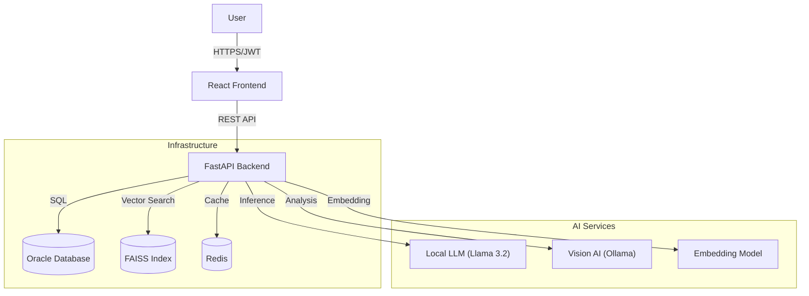
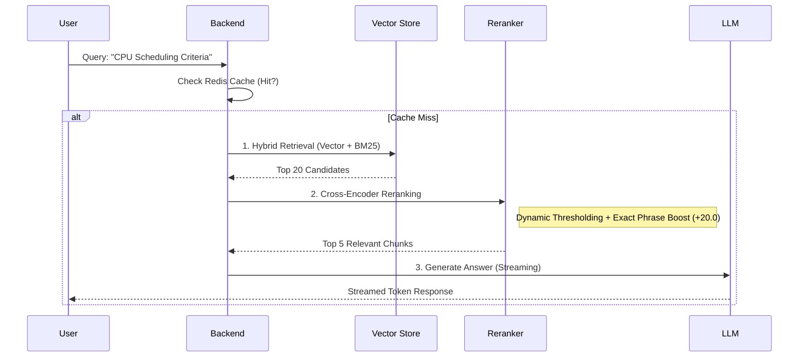

# IOC Secure Knowledge AI (ISK-AI)

## Prerequisites
- Python 3.10+
- Oracle Instant Client (if using Oracle DB)
- Tesseract OCR (for document ingestion)

## Setup

1.  **Create Virtual Environment**:
    ```bash
    python3 -m venv venv
    source venv/bin/activate
    ```

2.  **Install Dependencies**:
    ```bash
    pip install -r requirements.txt
    ```

3.  **Configure Environment**:
    Copy `.env.example` to `.env`:
    ```bash
    cp .env.example .env
    ```
    
    By default, the app is configured to use **SQLite** (`dev.db`) for easy local development.
    To use **Oracle**, uncomment the Oracle configuration lines in `.env` and comment out `CUSTOM_DATABASE_URL`.

4.  **Initialize Database**:
    The application automatically creates tables on startup in development mode.

## Running the Application

Start the server using Uvicorn:

```bash
uvicorn app.main:app --reload
```

- **Swagger UI**: [http://localhost:8000/docs](http://localhost:8000/docs)
- **API Root**: [http://localhost:8000/api/v1](http://localhost:8000/api/v1)

## Running Tests

To run tests, use `python -m pytest` from the project root:

```bash
python -m pytest tests/
```

**Note**: Do not run `pytest` directly or `python tests/test_api.py` as it may cause module import errors.

## Features

- **Document Ingestion**: Upload PDFs via `/api/v1/documents/upload`.
- **RAG Chat**: Query documents via `/api/v1/chat/query`.
- **Authentication**: Login via `/api/v1/auth/login`.
# IOCL-RAG-System

# System Architecture: IOCL-AI (Internal Search & Knowledge AI)

## 1. High-Level Overview
ISK-AI is a secure, Retrieval-Augmented Generation (RAG) system designed to allow users to query internal documents using natural language. It leverages local Large Language Models (LLMs) and Vector Search to provide accurate, context-aware answers while maintaining strict data privacy and security.

### Core Technology Stack
- **Frontend:** React (Vite), Tailwind CSS, Lucide React
- **Backend:** Python (FastAPI), SQLAlchemy, Pydantic
- **Database:** Oracle Database (Relational Data), FAISS (Vector Index)
- **Cache:** Redis (Response Caching, Rate Limiting)
- **AI/ML:**
    - **LLM:** Llama-3.2-3B (Quantized GGUF via `llama-cpp-python`)
    - **Embeddings:** `all-MiniLM-L6-v2` (SentenceTransformers)
    - **Reranker:** `ms-marco-MiniLM-L-6-v2` (CrossEncoder)
    - **Vision:** Ollama (Multimodal analysis for charts/handwriting)
    - **OCR:** Tesseract (Text extraction from scanned PDFs)

---

## 2. System Context Diagram (C4 Level 1)



---

## 3. Component Architecture

### 3.1 Backend Structure (Clean Architecture)
The backend follows a layered "Clean Architecture" pattern to ensure separation of concerns:

1.  **API Layer (`app/api`)**: Handles HTTP requests, validation (Pydantic), and Authentication (Dependencies).
2.  **Service Layer (`app/services`)**: Contains business logic (`RAGService`, `IngestionService`, `AuthService`).
3.  **Domain Layer (`app/domain`)**: Defines database models and repositories.
4.  **Infrastructure Layer (`app/infrastructure`)**: Handles external tools (LLM adapters, Vector Stores, PDF Parsers).

### 3.2 RAG Pipeline (The "Brain")
The core of the system is the RAG pipeline, optimized for accuracy and performance:



### 3.3 Ingestion Pipeline (Smart Processing)
Handles raw files and converts them into searchable vectors.

1.  **Upload:** API receives PDF/DOCX.
2.  **Extraction:**
    -   **Text:** `pdfplumber` extracts standard text.
    -   **OCR:** Tesseract handles scanned pages.
    -   **Vision Fallback:** If page contains "garbage" text (poor handwriting) or little text (<100 chars), **Ollama Vision AI** is triggered to visually describe the page.
3.  **Chunking:** Text is split into chunks (500 chars, 50 overlap).
4.  **Embedding:** `EmbeddingService` (Singleton) converts text to 384-dim vectors.
5.  **Storage:** Vectors -> FAISS, Metadata -> Oracle.

---

## 4. Key Design Decisions

### 4.1 Performance Optimizations
-   **Singleton Models:** Heavy AI models (Embeddings, Rerankers) are implemented as Singletons to prevent re-loading latency on every request.
-   **Hybrid Retrieval:** Combines semantic search (Vectors) with keyword search (BM25) to capture both conceptual and exact matches.
-   **Two-Stage Reranking:** Fast retrieval of 20-50 docs followed by precise Cross-Encoder sorting ensures high accuracy without speed compromise.

### 4.2 Security
-   **RBAC:** Role-Based Access Control ensures users only search documents they have permission to view.
-   **Audit Logging:** Every query and document access is logged to Oracle for compliance.
-   **Local Inference:** No data leaves the server; all AI processing is done locally.

### 4.3 Resilience
-   **Garbage Detection:** Heuristics detect poor OCR (e.g., repeating nonsense characters) and automatically switch to Vision AI.
-   **Caching:** Redis caches frequent queries to reduce load on the LLM.

## 5. Deployment View

| Container/Service | Port | Purpose |
|-------------------|------|---------|
| `app` | 8000 | FastAPI Backend |
| `frontend` | 5173 | React Frontend (Dev) |
| `ollama` | 11434 | Vision/LLM Server |
| `oracle` | 1521 | Relational DB |
| `redis` | 6379 | Caching |

---

---

## 6. Project Structure & Organization

The project follows a modular, domain-driven structure to ensure scalability and maintainability.

```
/Users/tushardeb/IOCL
├── app/
│   ├── api/                 # API Controllers (FastAPI Routes)
│   │   ├── auth.py          # Login & Token Generation
│   │   ├── chat.py          # RAG Query Endpoints
│   │   ├── documents.py     # File Upload & Management
│   │   └── deps.py          # Dependency Injection (User, DB)
│   │
│   ├── application/         # Business Logic Layer
│   │   ├── services/
│   │   │   ├── ingestion_service.py  # File Parsing, OCR, Chunking
│   │   │   ├── rag_service.py        # Search, Reranking, Generation
│   │   │   └── vision_service.py     # Image Analysis
│   │
│   ├── domain/              # Data Models & Schemas
│   │   ├── models.py        # SQLAlchemy Database Models
│   │   └── schemas.py       # Pydantic Data Validation Models
│   │
│   ├── infrastructure/      # Technical Implementations
│   │   ├── embeddings/      # SentenceTransformers Wrapper
│   │   ├── llm/             # Llama 3.2 Adapter (LocalLLMAdapter)
│   │   ├── vector_store/    # FAISS / Oracle Vector Store
│   │   └── rankers/         # Cross-Encoder Reranker
│   │
│   └── core/                # Core Configuration
│       ├── config.py        # Settings & Env Variables
│       └── database.py      # Oracle Connection Factory
│
├── frontend/                # React Frontend
│   ├── src/
│   │   ├── components/      # Reusable UI (ChatWindow, UploadForm)
│   │   ├── pages/           # Route Pages (ChatInterface, AdminDashboard)
│   │   └── services/        # API Client Wrappers
│
└── scripts/                 # Utility Scripts (Testing, Debugging)
```

---

## 7. Data Flow: How It Works

### 7.1 Detailed Ingestion Flow (File -> Knowledge)
When a user uploads a file, it goes through a rigorous transformation pipeline in `IngestionService`:

1.  **Validation**: `documents.py` validates file type (PDF, DOCX, CSV, Excel, PPT) and size.
2.  **Route Dispatch**: Based on extension:
    -   **PDF**: `pdfplumber` extracts text. If text is sparse (<100 chars), **OCR (Tesseract)** is triggered. If OCR output is garbage (gibberish), **Vision AI (Ollama)** looks at the page image.
    -   **Excel/CSV**: `pandas` converts rows/sheets into structured text strings.
    -   **PowerPoint**: `python-pptx` extracts text from slides.
3.  **Chunking**: Text is split into overlapping windows (500 chars, 50 overlap) to preserve context.
4.  **Embedding**: Each chunk is converted into a 384-dimensional vector using `all-MiniLM-L6-v2`.
5.  **Storage**:
    -   **Vector Index (FAISS):** Stores the 384-d float vector for fast similarity search.
    -   **Relational DB (Oracle):** Stores metadata (Chunk ID, Document ID, Content, Page Number, Content Hash).

### 7.2 Detailed RAG Query Flow (Question -> Answer)
When a user asks a question in the chat:

1.  **Authentication**: `deps.py` verifies the JWT token and extracts User ID/Roles.
2.  **Cache Check**: `RAGService` checks Redis for an identical query.
3.  **Hybrid Retrieval**:
    -   **Vector Search**: Finds conceptually similar chunks (e.g., "pay" matches "salary").
    -   **Keyword Search (BM25)**: Finds exact keyword matches.
    -   **Fusion**: Results are combined and deduped.
4.  **Reranking (The Quality Step)**:
    -   Top 20 candidates are passed to `CrossEncoder`.
    -   **Exact Match Boost**: If the query string exists verbatim in a chunk, it gets a massive score boost (+20.0).
    -   **Dynamic Threshold**: Chunks must score within a tight range of the best result to be kept.
5.  **Generation**:
    -   Top 3-5 chunks are formatted into a prompt within `Llama-3.2`.
    -   Model streams the answer token-by-token alongside citations.

---

## 8. Database Architecture

The system uses a **Hybrid Storage Model**:

### 8.1 Relational Database (Oracle)
Holds the "Truth" and Business Data.

*   **Users & Roles:** Authentication and RBAC tables.
*   **Documents:** File metadata (`filename`, `status`, `department`).
*   **DocumentChunks:** The actual text content and mapping to vectors.
*   **AuditLogs:** Compliance trail of every action.

**Schema Relationship:**
`User (1)` -> `(N) Document (1)` -> `(N) DocumentChunk`

### 8.2 Vector Index (FAISS)
Holds the "Search" Data.
*   Contains *only* the vectors and their `id`.
*   The `id` in FAISS directly maps to `DocumentChunk.id` in Oracle.

---

## 9. Future Roadmap
-   **Advanced Vision:** Support specific chart extraction (CSV generation from images).
-   **Fine-tuning:** Fine-tune Llama 3.2 on internal domain language (e.g., Oil & Gas jargon).


